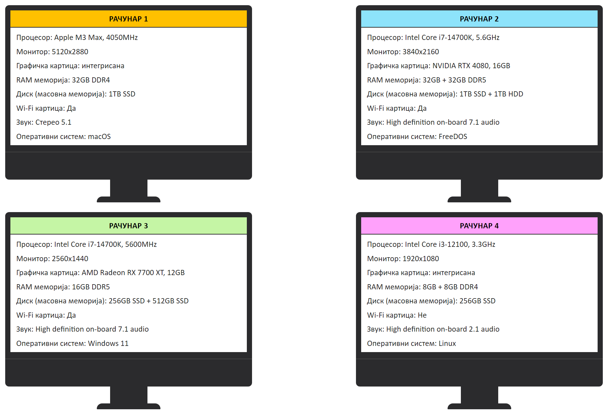

# Квиз: конфигурација рачунара



```{mchoice}
:answer1: 1;
:answer2: 2;
:answer3: 3;
:answer4: 4;
:correct: 4

Када бисмо гледали процесор, радну меморију и графичку картицу, који рачунар би био најслабији?
```

```{mchoice}
:answer1: 1;
:answer2: 2;
:answer3: 3;
:answer4: 4;
:correct: 2

Када бисмо гледали процесор, радну меморију и графичку картицу, који рачунар би био најјачи?
```

```{mchoice}
:answer1: 1;
:answer2: 2;
:answer3: 3;
:answer4: 4;
:correct: 1

Који монитор има најбољу резолуцију?
```

```{mchoice}
:answer1: 1;
:answer2: 2;
:answer3: 3;
:answer4: 4;
:correct: 2

Који рачунар има највише радне меморије?
```

```{mchoice}
:answer1: 1;
:answer2: 2;
:answer3: 3;
:answer4: 4;
:correct: 4

Који рачунар пружа најлошији квалитет звука?
```

```{mchoice}
:answer1: 1;
:answer2: 2;
:answer3: 3;
:answer4: 4;
:correct: 2,3

Који рачунар има најбржи процесор?
```

```{mchoice}
:answer1: 1;
:answer2: 2;
:answer3: 3;
:answer4: 4;
:correct: 4

На ком рачунару се може ускладиштити најмање података?
```

```{mchoice}
:answer1: 1;
:answer2: 2;
:answer3: 3;
:answer4: 4;
:correct: 2

Који рачунар има најбољу комбинацију дискова за складиштење велике количине података?
```

```{mchoice}
:answer1: 1;
:answer2: 2;
:answer3: 3;
:answer4: 4;
:correct: 4

Који рачунар не може да се повеже на бежичну мрежу?
```

```{mchoice}
:answer1: 1;
:answer2: 2;
:answer3: 3;
:answer4: 4;
:correct: 3

На ком рачунару је Microsoft оперативни систем?
```
