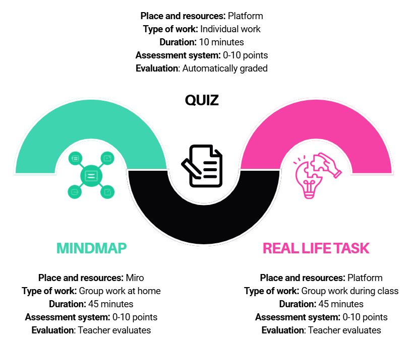

# Структура часа

**Ова лекција има три компоненте:**



На крају наставног часа вредноваће се сваки део вашег рада:

- **Израда менталне мапе** – структура, садржај, јасноћа приказа и сарадња у групи (10 поена)

- **Самостални задатак** – тачност одговора и разумевање садржаја у квизу (10 поена)

- **Рад у групи** – допринос тимском раду, аргументовање идеја и учешће у расправи (10 поена)


| Закључна оцена | Поени |
| ---------------| ------|
| Одличан (5)    | 27–30 |
| Врло добар (4) | 23–26 |
| Добар (3)      | 19–22 |
| Довољан (2)    | 15–18 |
| Недовољан (1)  | 0–14  |


```{suggestionnote} 
Ваша коначна оцена неће зависити само од знања, већ и од начина на који учествујете у раду, сарађујете с другима и доприносите позитивној радној атмосфери унутар тима. Да би рад у тиму био успешан, важно је придржавати се следећих правила сарадње:
- 	Сви чланови тима имају једнаку вредност и према свима се односимо с поштовањем.
- 	Одржавамо конструктивну и позитивну атмосферу, чак и када имамо различита мишљења.
- 	Сваки члан преузима одговорност за свој допринос и за заједнички резултат тима.
- 	Подстичемо све чланове да активно учествују у решавању задатка.
- 	У доношење одлука настојимо укључити све чланове тима.
- 	Разматрамо различите идеје и бирамо решење које најбоље одговара задатку.
- 	Идеје развијамо заједнички, расправљамо о њима и обликујемо коначна решења.
- 	Време користимо одговорно да бисмо задатак завршили у предвиђеном року.
- 	Пратимо напредак групе и договарамо даље кораке.
```

На следећој страни наћи ћеш упутство за израду менталне мапе.
