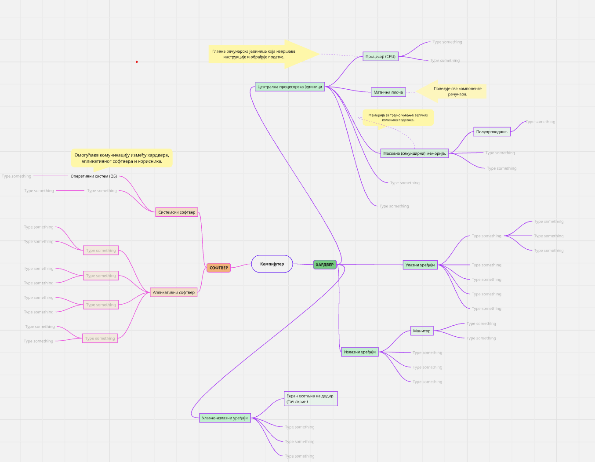

# Ментална мапа

**Упутство за израду менталне мапе**

1.  Поделите се у групе од 3 до 4 члана по сопственом избору.

2.  Отворите [Miro](https://www.miro.com) и заједно започните израду менталне мапе:

    а.  Сви чланови групе се региструју на Miro платформу користећи
        школски мејл.

    б.  Један члан групе ствара мапу, копира је на нову мапу повезану са својим налогом и позива остале чланове групе
        како би сви могли да уређују мапу.

3.  Погледајте шаблон менталне мапе објављен на Петљи и, на основу
    претходно обрађених лекција, израдите своју групну мапу. На мапи
    треба да буду приказани сви поменути уређаји и њихове поделе, при
    чему је важно применити знање које сте раније усвојили.

4.  По жељи додајте кратке белешке (нпр. шта која компонента ради и
    које су јој битне карактеристике) и слике или иконе.

5.  Ако ти је у учењу потребна додатна подршка, можеш прилагодити
    изглед мапе: користити већи фонт, јасне боје или уметнути иконе и
    визуелне ознаке.

6.  Када завршите, извозите мапу у облику слике и предајте је путем
    Петље у наредној активности.

